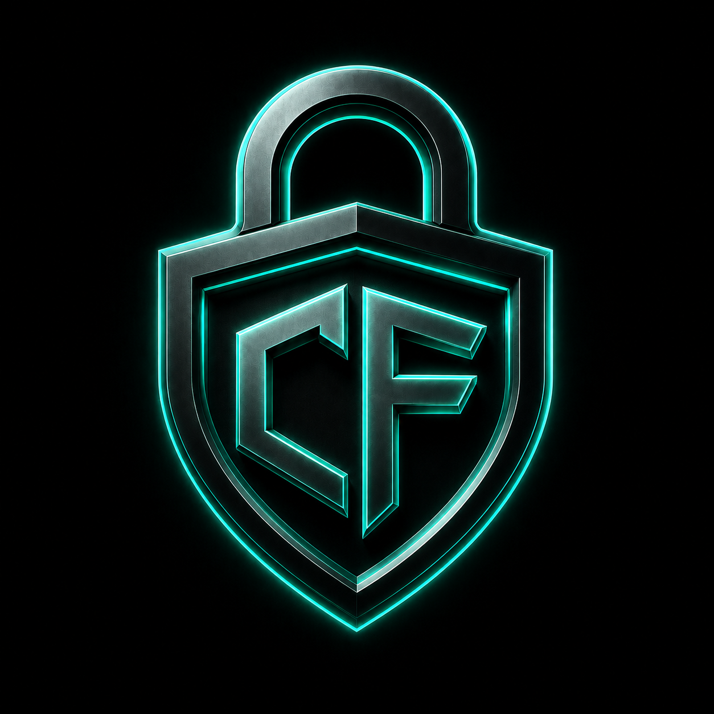
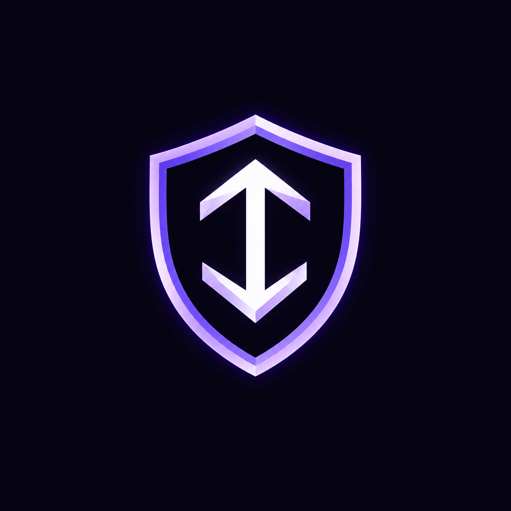

 

---

<table>
<tr>
<td width="58%" valign="top">

## 👩‍💻 About Me

Hi! I'm **Arusham Tahir**, an ICS graduate exploring the world of cybersecurity, cloud security, and digital safety.

- 🛡️ Learning cybersecurity fundamentals
- ☁️ Exploring Microsoft security and cloud concepts
- 🔐 Interested in identity and access management
- 📚 Documenting my learning journey
- 🌐 Building projects to promote online safety

> **My mission:** Learn responsibly. Build useful things. Help people stay safer online.

</td>
<td width="42%" valign="top">

## ⚡ Quick Links

</td>
</tr>
</table>

## 🧰 Skills & Technologies

## 🚀 Featured Projects

  <table>
    <tr>
      <td align="center" width="50%">
        
        <h3>🔐 Cyber Funnel</h3>
        
Cybersecurity awareness, online privacy and digital safety.

        
      </td>
      <td align="center" width="50%">
        
        <h3>🛡️ CyberTraceX</h3>
        
Beginner-friendly cybersecurity guides and interactive learning.

        
      </td>
    </tr>
  </table>

## 🎓 Verified Digital Badges

  <table>
    <tr>
      <td align="center" width="33%">
        
         <strong>IBM</strong>
         Getting Started with Cybersecurity
         <a href="https://www.credly.com/badges/3b46f271-2cf9-49ed-a179-e8466204fa08">View Credential ↗</a>
      </td>
      <td align="center" width="33%">
        
         <strong>Fortinet</strong>
         Cybersecurity 3.0
         <a href="https://www.credly.com/badges/bafab564-b18b-42ea-9760-c26474ad8236/public_url">View Credential ↗</a>
      </td>
      <td align="center" width="33%">
        
         <strong>Linux Foundation</strong>
         Cybersecurity Essentials
         <a href="https://www.credly.com/badges/31b16d15-2c1a-4f8e-9c8e-5e7880b1e175/public_url">View Credential ↗</a>
      </td>
    </tr>
  </table>

  
   Microsoft Security, Compliance & Identity
   <a href="https://learn.microsoft.com/en-us/users/arusham-tahir-5871/transcript/7k1wni8nml05xl3?tab=applied-skills-tab">View Learning Record ↗</a>

## 📊 GitHub Command Center

## 🤝 Let's Connect

**Interested in cybersecurity, technology, or learning together? Let's connect!**

  

**`LEARN` · `BUILD` · `SECURE` · `GROW`**

Thanks for visiting my profile! 💜

