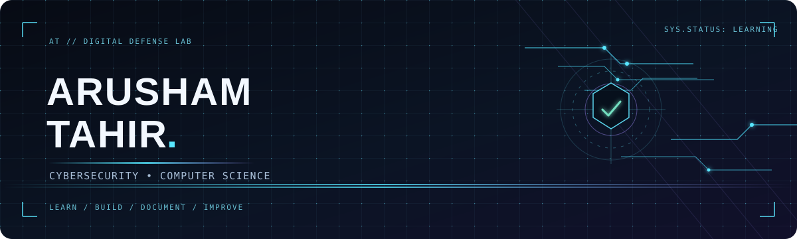

 

---

## `whoami` — A little about me

Hi, I'm **Arusham Tahir** — an ICS graduate exploring the intersection of **cybersecurity, computer science, cloud security, and digital safety**.

I enjoy turning what I learn into clear notes, practical projects, and beginner-friendly resources. My focus is on building strong foundations, documenting progress, and making online safety easier to understand.

- 🛡️ Exploring cybersecurity, identity, compliance, and network defense
- ☁️ Learning Microsoft security and cloud concepts
- 🧠 Maintaining structured revision notes in my **CyberSecurity MasterLog**
- 🌐 Building **Cyber Funnel**, a beginner-friendly cybersecurity awareness platform
- 📚 Learning in public and improving one project at a time

> `Mission: learn responsibly • build useful things • help people stay safer online`

---

## 🧭 Featured Projects

<table>
<tr>
<td width="50%" valign="top">

### 🔐 Cyber Funnel

**Cybersecurity Awareness Platform**

A beginner-friendly collection of practical guides on phone privacy, public Wi-Fi safety, account security, and common online risks.

</td>
<td width="50%" valign="top">

### 🕵️ CyberTraceX

**Cybersecurity Project**

Explore my CyberTraceX project and its features.

</td>
</tr>
<tr>
<td width="50%" valign="top">

### 📘 CyberSecurity MasterLog

**Study Notes & Revision Log**

A self-maintained repository of structured notes on Microsoft SC-900 topics, Fortinet security learning paths, cloud compliance, identity, and infrastructure controls.

</td>
<td width="50%" valign="top">

### 🌐 Portfolio

**Projects & Learning Journey**

Visit my portfolio to explore my work, projects, and cybersecurity learning journey.

</td>
</tr>
</table>

---

## 🎓 Certifications & Learning Credentials

Click a badge to view its public credential or learning record.

<table>
<tr>
<td align="center" width="50%">

**Microsoft**

### Security, Compliance & Identity (SC-900)

</td>
<td align="center" width="50%">

**Linux Foundation**

### Cybersecurity Essentials (LFC108)

</td>
</tr>
<tr>
<td align="center" width="50%">

**IBM**

### Getting Started with Cybersecurity

</td>
<td align="center" width="50%">

**Fortinet**

### Getting Started in Cybersecurity 3.0

</td>
</tr>
</table>

---

## 🧰 Current Focus & Tools

---

## 📊 GitHub Dashboard

 

Stats are generated by third-party services and may occasionally be unavailable. Language cards reflect repository code, not a complete measure of proficiency.

---

## 🤝 Let's Connect

I'm happy to connect with fellow learners, developers, and people interested in cybersecurity awareness.

**`[ LEARN ]` · `[ DOCUMENT ]` · `[ BUILD ]` · `[ SHARE ]`**

Designed with curiosity and a commitment to responsible cybersecurity learning.

